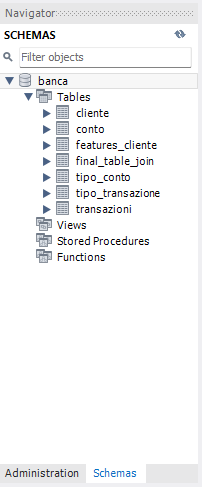
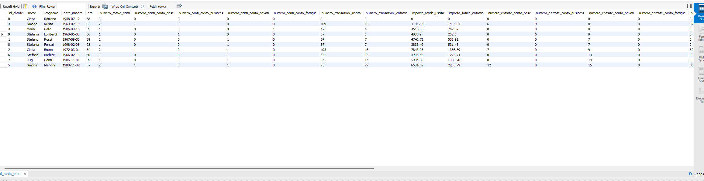
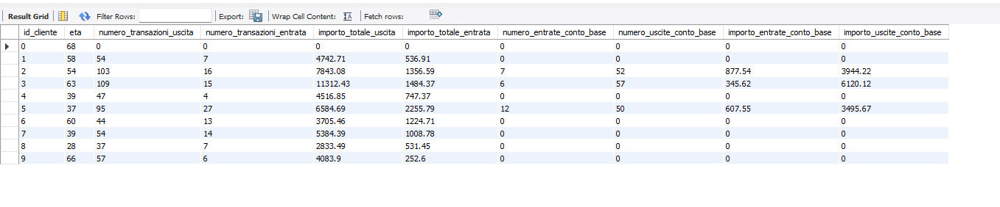
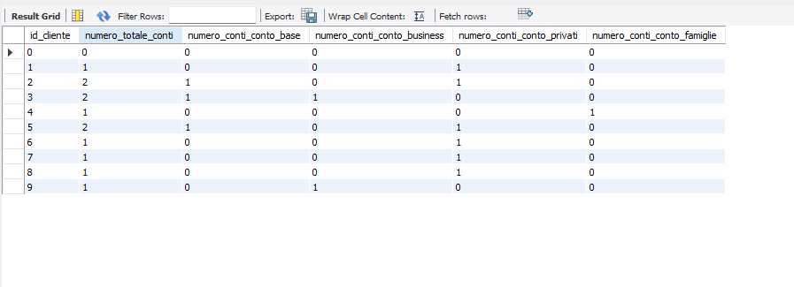
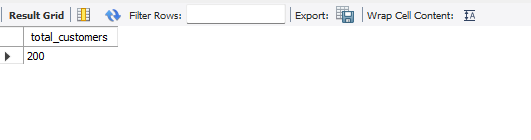

# 🏦 Banking Customer Analysis – SQL Feature Engineering
## 📌 Project Overview
This project focuses on transforming a relational banking database into a denormalized customer-level dataset using SQL.

The project is based on a business scenario in which Banking Intelligence aims to develop supervised Machine Learning models to predict customer behavior based on transactional activities and account ownership.

The objective is to extract meaningful behavioral indicators (features) from multiple relational tables and combine them into a single dataset, with one record per customer.
Using SQL queries, joins, aggregations, temporary tables, and conditional expressions, the project generates a comprehensive set of quantitative and qualitative features describing customer characteristics, account ownership, and financial transactions.

The final dataset contains 200 customers and is designed to serve as a foundation for future Machine Learning applications.

## 🗂️ Dataset
The project uses a relational banking database consisting of five original tables:

- **Cliente:** Contains customer information, including personal details and date of birth.
- **Conto:** Contains information about bank accounts owned by customers.
- **Tipo_conto:** Describes the different types of bank accounts available.
- **Tipo_transazione:** Contains transaction classifications, including the direction of each transaction.
- **Transazioni:** Contains the details of financial transactions performed on bank accounts.

The original tables are connected through customer IDs, account IDs, and transaction type IDs.

**Database:** db_bancario

**Database Format:** MySQL.

**Final Dataset:** 200 customers.

## 🎯 Project Objectives
The main objectives of the project were:

- Explore and understand the structure of the relational banking database.
- Integrate information from multiple tables using SQL joins.
- Calculate the number and total amount of incoming and outgoing transactions for each customer.
- Analyze customer account ownership and identify the number of accounts held by each customer.
- Calculate account ownership indicators for each account type.
- Generate transaction indicators grouped by account type and transaction direction.
- Aggregate all calculated indicators at customer level.
- Create a denormalized dataset containing one record per customer.
- Prepare a structured feature table for potential use in supervised Machine Learning models.

## 🛠️ Tools & Techniques
- MySQL
- MySQL Workbench
- SQL
- SELECT Statements
- INNER JOIN
- LEFT JOIN
- GROUP BY
- Aggregate Functions (COUNT, SUM, MAX)
- Conditional Aggregations (CASE WHEN)
- Temporary Tables
- CREATE TABLE AS SELECT
- COALESCE
- Data Transformation
- Data Aggregation
- Feature Engineering
- Database Denormalization
- Machine Learning Data Preparation
  
## 📂 Project Structure
The project was developed using MySQL Workbench and organized into the following main stages:

- Database Exploration
- Transaction Indicators Calculation
- Account Ownership Analysis
- Customer-Level Aggregation
- Transaction Analysis by Account Type
- Final Feature Table Creation
- Final Dataset Validation
- Project Workflow

## 1. Database Exploration
The first stage involved inspecting the five original tables to understand the database structure and the relationships between customers, accounts, transaction types, and transactions.

Key activities:

- Exploring the customer table.
- Examining account ownership information.
- Identifying available account types.
- Understanding transaction classifications.
- Inspecting transaction records and their relationships with bank accounts.

## 2. Transaction Indicators Calculation
The next stage focused on calculating incoming and outgoing transaction indicators at account level.

Two temporary tables were created:

 - **totale_uscite:** Contains the number of outgoing transactions and their total amount for each account.
- **totale_entrate:** Contains the number of incoming transactions and their total amount for each account.

The transaction direction was identified using the segno field from the transaction type table.

The main SQL functions used were:

- COUNT() to calculate transaction frequency.
- SUM() to calculate total transaction amounts.
- ABS() to standardize transaction amounts.
- ROUND() to round monetary values to two decimal places.

## 3. Account Ownership Indicators
This stage focused on analyzing the number and types of bank accounts owned by each customer.

A temporary table named *numero_conti* was created to calculate:

- Total number of accounts.
- Number of basic accounts.
- Number of business accounts.
- Number of private accounts.
- Number of family accounts.

Conditional aggregation using CASE WHEN was used to calculate the number of accounts for each category.

## 4. Account-Level Customer Summary
The customer information, account characteristics, and transaction indicators were combined into an intermediate temporary table named *riepilogo_cliente_conti*.

The table was created using LEFT JOIN operations to connect:

- Customer information.
- Account ownership data.
- Account-level transaction indicators.
- Incoming and outgoing transaction totals.

The COALESCE() function was used to replace missing transaction indicators with zero.

## 5. Customer-Level Feature Engineering
The intermediate account-level dataset was aggregated to obtain one record per customer.

A table named *features_cliente* was created containing:

- Customer identification and personal information.
- Total number of accounts.
- Number of accounts by account type.
- Total number of incoming transactions.
- Total number of outgoing transactions.
- Total incoming transaction amounts.
- Total outgoing transaction amounts.

The COUNT(DISTINCT) function was used to count unique accounts, while SUM() and MAX() were used to aggregate customer-level indicators.

## 6. Transaction Metrics by Account Type
A further temporary table named *movimenti_cliente_per_tipo_conto* was created to analyze customer transactions according to account type.

The indicators were calculated separately for incoming and outgoing transactions.

The resulting features include:

- Number of incoming transactions by account type.
- Number of outgoing transactions by account type.
- Total incoming amounts by account type.
- Total outgoing amounts by account type.

Conditional aggregation using CASE WHEN allowed the calculation of multiple indicators within a single SQL query.

## 7. Final Customer Feature Table
The final stage consisted of combining the customer-level features with the transaction indicators grouped by account type.

The resulting table, *final_table_join*, contains a comprehensive set of customer-level features, including:

- Customer ID.
- First and last name.
- Date of birth.
- Customer age.
- Total number of accounts.
- Number of accounts by account type.
- Total incoming and outgoing transaction counts.
- Total incoming and outgoing transaction amounts.
- Incoming transaction counts by account type.
- Outgoing transaction counts by account type.
- Incoming transaction amounts by account type.
- Outgoing transaction amounts by account type.

Customer age was calculated using TIMESTAMPDIFF() and CURDATE().

The final table was designed to contain one record for each customer and offers a denormalized structure, suitable for further analysis and for preparation for machine learning.

## 8. Final Dataset Validation
The final table was inspected using SELECT queries to verify its structure and review the generated customer-level indicators.

The resulting dataset contains:

**Total Customers: 200**

The final table provides a consolidated representation of customer characteristics, account ownership, and transactional behavior.

## 💡 Business Value
The denormalized customer feature table provides a valuable foundation for several potential banking applications:

- **Customer Behavior Prediction:** Behavioral indicators can support the development of predictive models to anticipate future customer actions.
- **Customer Churn Analysis:** Transaction frequency and account ownership patterns can help identify customers potentially at risk of leaving the bank.
- **Customer Segmentation:** Account ownership and transaction activity can support the identification of different customer profiles.
- **Personalized Marketing:** Customer-level features can help develop more targeted banking products and services.
- **Financial Risk Analysis:** Transactional indicators can provide useful information for future customer risk evaluation models.
- **Fraud Detection:** Transaction patterns and financial activity indicators can serve as potential inputs for future anomaly detection systems.

These applications represent potential future uses of the dataset. The project focuses on SQL-based data preparation and feature engineering rather than training predictive models.

## 🎓 Conclusion
This project demonstrates how SQL can be used to transform a relational banking database into a structured and denormalized dataset suitable for advanced data analysis and future Machine Learning applications.

By combining multiple tables, applying joins, performing aggregations, and creating customer-level indicators, the project successfully generated a comprehensive feature table containing 200 customers.

The final dataset integrates information about customer characteristics, account ownership, and financial transactions, providing a structured foundation for further analytical activities.

Overall, this project strengthened practical skills in SQL querying, relational database management, data transformation, aggregation, and feature engineering.

It also provided valuable experience in preparing structured datasets for potential use in supervised Machine Learning applications.

## 📁 Repository Contents
- **[Analysis_of_a_bank's_customers.sql](Analysis_of_a_bank's_customers.sql):** SQL script containing the complete database exploration, transaction aggregations, account indicators, customer-level feature engineering, and final table creation.
- **[DATA](DATA):** Original SQL database containing the five source tables used for the analysis.
- **[images](images):** Folder containing screenshots of the database structure, intermediate feature tables, and final customer-level dataset.

## 📸 Project Preview
## 1. Database Structure
Overview of the five original relational tables and the two additional tables generated during the project.

## 2. Final Customer Feature Table
Preview of the denormalized customer-level dataset containing the main behavioral indicators.

## 3. Transaction Features
Overview of incoming and outgoing transaction indicators calculated for each customer.

## 4. Account Ownership Features
Overview of customer account ownership indicators, including the distribution by account type.

## 5. Final Dataset – Customer Count
Verification of the total number of customers included in the final feature table.

## 📬 Contact
- **Silvia Venturini**
- [LinkedIn](https://www.linkedin.com/in/silvia-venturini92/)
- **Email:** silvia.venturini92@hotmail.com
